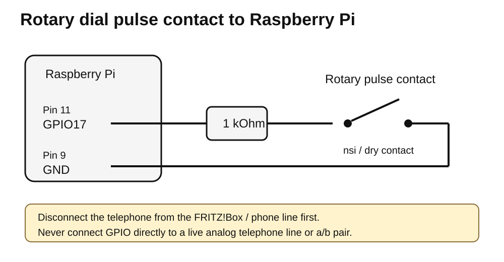

# Rotary Dial Pulse Tester

A small Raspberry Pi tool for measuring and diagnosing pulse dialing (rotary dial / loop-disconnect dialing).

It was created while adjusting a German **FeTAp 611-2** rotary phone for use with a **FRITZ!Box 7530**, but it should work with many mechanical rotary dials that expose a dry pulse contact.

The script measures pulse count, detected digit, open/closed timing, pulse period, pulse rate, and raw short transitions.

## Safety

**Do not connect a Raspberry Pi GPIO directly to a live telephone line, TAE connector, FRITZ!Box FON port, or the phone's `a/b` line.** Analog telephone ports can carry voltages far above the Raspberry Pi's 3.3 V GPIO limit.

Use this tester only on an **isolated mechanical pulse contact**. Disconnect the phone from the FRITZ!Box / line first; ideally disconnect the dial assembly from the phone circuit too.

## Hardware

- Raspberry Pi with 40-pin GPIO header (tested on Raspberry Pi 5)
- 2 female Dupont jumper wires
- 1 kΩ resistor
- Rotary dial pulse contact
- Optional mini-hook test leads

The resistor is not required for the measurement itself, but adds a little protection against wiring mistakes.

## Wiring

Default pins:

- **GPIO17** = physical pin **11**
- **GND** = physical pin **9**



```text
Pi pin 11 / GPIO17
        |
       1 kΩ
        |
        +------ rotary pulse contact ------+
                                            |
Pi pin 9 / GND -----------------------------+
```

No external 3.3 V or 5 V connection is required. The script enables the Pi's internal pull-up.

```text
contact closed -> GPIO LOW
contact open   -> GPIO HIGH
```

## Identifying the pulse contact

With the phone disconnected:

1. Set a multimeter to continuity mode.
2. Find a pair that is closed at rest.
3. Dial `0`.
4. During return, that pair should open about ten times.

This contact is often called **nsi** in German rotary-phone documentation. Do not rely on wire color alone; verify it with a meter.

## Install

On Raspberry Pi OS:

```bash
sudo apt update
sudo apt install python3-gpiozero python3-lgpio
```

Run:

```bash
python3 dial_test.py
```

## Example output

```text
============================================================
Detected digit: 0
Pulse count:    10

Open times:
    59.9    59.4    59.6    60.0    59.8    60.7    60.7    60.9    61.4    61.7 ms
Closed times:
    33.8    34.5    35.1    35.2    35.1    35.1    35.5    35.4    35.3 ms

Open mean:        60.4 ms
Closed mean:      35.0 ms
Pulse period:     95.4 ms
Pulse rate:      10.48 pulses/s
```

The full sample is in `examples/sample-output.txt`.

## Interpreting results

A practical target for classic pulse dialing is roughly:

```text
pulse rate:       ~10 pulses/s
period:           ~100 ms
open time:        ~60 ms
closed time:      ~40 ms
```

A useful working range for adjustment is about **9.5 to 10.5 pulses/s**. Slightly outside that may still work, depending on the exchange, PBX, router, or ATA.

A dial at ~16 pulses/s is far too fast and can make modern equipment confuse adjacent digits, for example `9 <-> 0` or `3 <-> 4`.

## Short "bounce" events

The script intentionally preserves raw transitions. Very short events such as `0.01 ms` are not automatically proof of real mechanical bounce; they may also be GPIO/driver/event artifacts. They are filtered out of the interpreted pulse count and timing but still shown for diagnostics.

## Pulse signal


Digit mapping:

```text
1 -> 1 pulse
2 -> 2 pulses
...
9 -> 9 pulses
0 -> 10 pulses
```

## Mechanical adjustment notes

The mechanism varies by manufacturer. Typical causes of wrong speed include sticky bearings, contaminated governor/brake surfaces, oil on a friction surface, incorrect governor spring tension, or damaged governor parts.

If a dial becomes much faster after lubrication, check whether oil reached a governor braking/friction surface. Measure first, make one small adjustment, and measure again.

## Repository layout

```text
rotary-dial-pulse-tester/
├── README.md
├── LICENSE
├── .gitignore
├── dial_test.py
├── docs/
│   ├── wiring.svg
│   └── pulse-signal.svg
└── examples/
    └── sample-output.txt
```

## License

MIT
